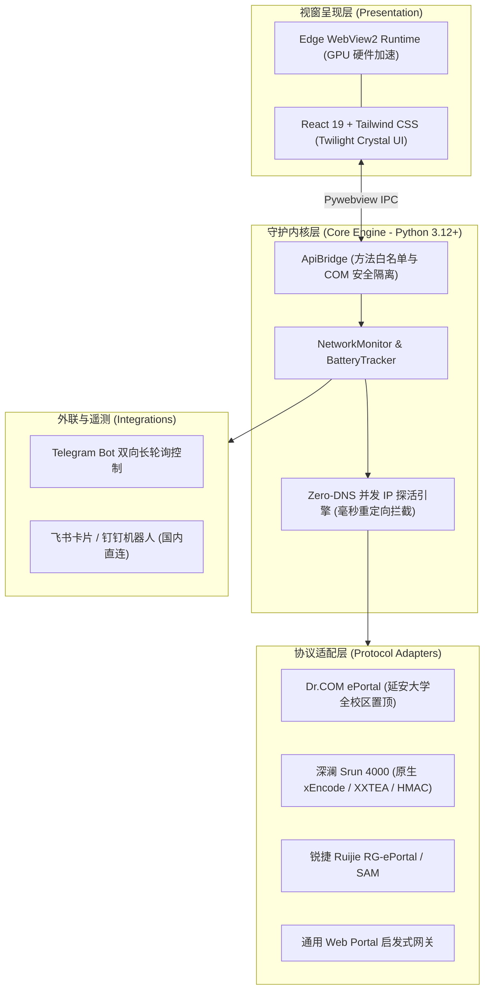

# Campus Guard

<p align="center">
  <a href="https://github.com/MH-ai-ai/campus-tool/releases/latest"></a>
  
  
  
  
  <a href="LICENSE"></a>
</p>

---

## 概述与设计理念

**Campus Guard** 是面向 Windows 操作系统的高校校园网络自动化认证与状态自愈常驻守护系统。针对高校校园网络中广泛存在的认证过期掉线、宿舍定时断电、无线接入点漫游漂移以及 Captive Portal 强制重定向拦截等典型场景设计。

项目以**延安大学（Yan'an University）**全校区校园网网络环境为核心原型进行深度量身定制，并完整覆盖国内主流高校认证体系（城市热点 Dr.COM、深澜 Srun 4000/Portal、锐捷 Ruijie SAM/ePortal 及通用 Web Portal）。

### 核心系统特征

* **原生视窗渲染架构**：采用 Windows 原生 Edge Chromium WebView2 引擎，搭载 React 19 与 Twilight Crystal Glass（微光水晶）设计范式，支持 GPU 硬件栅格化加速，根除传统脚本 GUI 的顿挫与撕裂；
* **零 DNS 延迟嗅探引擎**：在未认证且外部 DNS 阻断的网络环境下，通过网关与公网原始 IP 并发探针拦截 Captive Portal 302 重定向，将网关嗅探耗时从数分钟降至毫秒级（5~50ms）；
* **全自主协议密码学实现**：纯 Python 原生算法实现深澜 Srun 4000 的 xEncode / XXTEA 对称加密算法与 64 字符密码表 Base64 编码，零外部 Node.js 运行时依赖；
* **毫秒自愈与后台轻量常驻**：基于内核套接字无损探活，网络波动时毫秒级自动重连；稳定运行时自动进入浅休眠模式，配合底层物理内存工作集修剪；
* **双向遥测与国内免梯通报**：原生支持飞书自适应状态卡片、钉钉加签 Markdown 通报；支持 Telegram 手机端双向远程指令控制（无公网 IP 限制）；
* **本地加密与电源安全守护**：敏感凭据采用本地对称密钥（Fernet）加密存储；笔记本低电量多梯次预警，电量低于阈值时触发可撤销安全关机保护。

---

## 系统拓扑与工程架构



---

## 高校认证体系支持矩阵

| 认证协议体系 | 核心算法与交互规范 | 适配高校与场景覆盖 |
| :--- | :--- | :--- |
| **Dr.COM ePortal** | JSONP `dr1003` / `dr1004`，多运营商前缀后缀智能格式化 | **延安大学（默认原型 · 新校区/杨家岭/萃园）**、吉林大学等 |
| **深澜 Srun 4000** | Challenge 挑战盐捕获、原生 xEncode / XXTEA、HMAC-MD5、自定义 Base64 | **清华大学、浙江大学、北京邮电大学、深圳大学** 等高校 |
| **锐捷 Ruijie** | REST `/eportal/InterFace.do`，动态参数绑定与表单推送 | 众多工科与综合类高等院校（RG-ePortal / SAM） |
| **通用 Web Portal** | 启发式表单字段分析、Meta 刷新拦截与 POST 会话维护 | 各高校自研或第三方定制认证门户 |

---

## 快速使用指引

### 方式一：下载绿色便携版（推荐）

1. 从 [**GitHub Releases**](https://github.com/MH-ai-ai/campus-tool/releases/latest) 下载最新版 `CampusGuard-v2.2.0-Windows-x64.zip`；
2. 解压到本地任意目录（系统需为 64 位 Windows 10 或 Windows 11，内置 Edge 即可，无需安装 Python 或 Node.js）；
3. 双击 `CampusGuard.exe` 启动系统，控制中心将自动常驻任务栏托盘；
4. 连入校园 Wi-Fi，在首页输入学号与密码，点击「一键极速联网」，系统将全自动识别网关参数、完成认证并开启后台自愈守护。

### 方式二：从源码运行与二次开发

#### 1. 环境准备
- Python 3.11 或 3.12 (64-bit)
- Node.js 20+ 与 npm

#### 2. 克隆与依赖安装
```powershell
git clone https://github.com/MH-ai-ai/campus-tool.git
cd campus-tool

# 编译现代化前端资源
cd frontend
npm install
npm run build
cd ..

# 搭建 Python 虚拟环境
py -3.12 -m venv .venv
.\.venv\Scripts\python.exe -m pip install --upgrade pip
.\.venv\Scripts\python.exe -m pip install -r requirements.txt
```

#### 3. 运行与测试
```powershell
# 运行完整自动化测试套件 (53 项单元测试)
.\.venv\Scripts\python.exe -m unittest discover tests -v

# 启动控制中心客户端
.\.venv\Scripts\python.exe "campus_guard.pyw"
```

---

## 核心配置说明 (`config.json`)

系统在首次运行时于根目录自动初始化 `config.json`。密码及敏感 Token 在本地持久化时均经对称密钥（Fernet）加密保护：

| 配置键名 | 类型 | 说明 | 缺省参考值 |
| :--- | :--- | :--- | :--- |
| `university_name` | `string` | 当前匹配高校模板名称 | `"延安大学 (默认 · Dr.COM)"` |
| `auth_protocol` | `string` | 认证协议体系 (`drcom` / `srun` / `ruijie` / `portal`) | `"drcom"` |
| `campus_account` | `string` | 校园网学号 / 认证账号 | `""` |
| `campus_password` | `string` | 校园网认证密码（持久化自动加密） | `""` |
| `campus_auth_url` | `string` | 认证网关接口 URL（支持全自动嗅探） | `"http://10.200.84.3:801/eportal/portal/login"` |
| `campus_gateway` | `string` | 校园网网关探测 IP | `"10.211.0.1"` |
| `network_check_interval_seconds`| `integer`| 断网自愈与网络连通性探测周期 (秒) | `2` |
| `auto_shutdown_threshold` | `integer`| 宿舍断电触发安全关机的电池阈值百分比 | `20` |
| `feishu_webhook_url` | `string` | 飞书自定义机器人 Webhook（国内免代理） | `""` |
| `dingtalk_webhook_url`| `string` | 钉钉自定义机器人 Webhook（国内免代理） | `""` |
| `telegram_bot_token` | `string` | Telegram Bot 凭据（双向远程控制） | `""` |

---

## 高校规则库扩展

项目内置全国高校认证规则库。如需补充或更新所属院校的网关模板，可在 [`data/universities.json`](data/universities.json) 中添加配置项并提交 Pull Request：

```json
{
  "id": "university_code",
  "name": "大学名称 (体系说明)",
  "pinyin": "daxuemingcheng dxmc",
  "protocol": "drcom",
  "auth_url": "http://10.0.0.1/eportal/index.jsp",
  "gateway": "10.0.0.1",
  "wifi_ssids": ["Campus-WiFi"],
  "domain_keywords": ["example.edu.cn"]
}
```

---

## 开源许可证 (License)

本项目遵循 [MIT License](LICENSE) 许可协议发布。  
特别致敬延安大学（Yan'an University）校园网络环境对本项目的测试支持。
