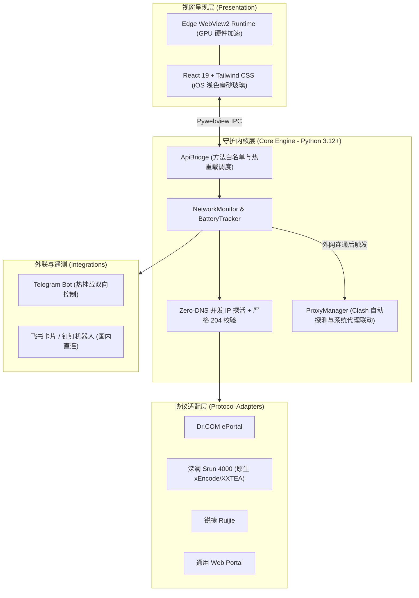

<div align="center">
  
  <h1>安澜 · AnLan</h1>
  <p><strong>愿校园网从此风平浪静</strong></p>
  <p>专为中国高校打造的 Windows 校园网全自动认证、断网自愈、Clash 代理联动与宿舍断电守护桌面工具</p>

  <p>
    <a href="https://github.com/MH-ai-ai/campus-tool/releases/latest"></a>
    <a href="https://github.com/MH-ai-ai/campus-tool/stargazers"></a>
    
    
    
    
    
  </p>

  <p>
    <a href="#为什么需要安澜">痛点背景</a> ·
    <a href="#安澜-vs-传统校园网脚本">直观对比</a> ·
    <a href="#安澜能为你做什么">核心能力</a> ·
    <a href="#30-秒极速上手">极速上手</a> ·
    <a href="#高校认证体系支持">支持协议</a> ·
    <a href="#系统拓扑与工程架构">系统架构</a>
  </p>
</div>

---

## 为什么需要安澜？

如果你也在用高校校园网，下面这些崩溃瞬间一定似曾相识：

* **半夜/定时踢下线，远程直接失联**：在图书馆或实验室正通过远程桌面连宿舍电脑，突然校园网认证过期断开，实验、下载或挂机任务全部卡死；
* **开机先开代理，结果连不上校园网**：Clash 先于校园网启动并接管代理或路由，导致认证页面打不开；不开自启又得每次连上网再手动去开 Clash；
* **开了电脑移动热点或虚拟网卡，脚本直接误判**：Windows 移动热点（`192.168.137.1`）或 VPN/TUN 网卡在线，加上校园网未认证前放行 DNS 53 端口，普通脚本以为“已经在线”，直接跳过登录认证；
* **宿舍定时断电无人看守**：晚上宿舍熄灯断电，笔记本电量耗尽强制黑屏关机，未保存的论文、代码和实验状态全部丢失；
* **Windows 11 任务栏定位图标狂闪**：很多脚本每隔几秒或几分钟轮询 `netsh wlan`，导致右下角定位权限图标不停闪烁，非常烦人；
* **简陋黑框 + 配置地狱**：需要自己装 Python、抓包找 `wlan_ac_ip` / 网关 URL，遇到 Dr.COM `,0,` 前缀或深澜加密就抓瞎。

**「安澜」就是为了彻底终结这些琐碎而诞生的**——让你开机不用管 Wi-Fi、不用管认证弹窗、不用管 Clash 顺序、不用担心断电丢数据，把校园网变成像家里宽带一样“无感在线”的基础设施。

---

## 安澜 vs 传统校园网脚本

| 对比维度 | 传统校园网脚本 / 定时任务 | 安澜 (AnLan) |
| :--- | :--- | :--- |
| **开机全自动链路** | 需要手写批处理或额外配任务计划，黑框一闪而过 | **开机 `--minimized` 静默藏入托盘**，自动连 Wi-Fi → 认证 → 拉起代理 |
| **假在线与热点抗干扰** | 仅靠 `ping` 或 53 端口，开移动热点或未认证也常误判在线 | **严格 Captive 204 / 正文 / HTTPS 校验**，屏蔽 `192.168.137.*` 与虚拟网卡 |
| **Clash 代理联动** | 无联动；开机先开代理经常挡住校园网认证 | **先认证外网，再启动 Clash Verge 等客户端**，端口就绪后自动开系统代理并绕过内网 |
| **Win11 定位图标** | 频繁调 `netsh wlan` 触发系统定位图标狂闪 | **`psutil` 网卡签名缓存 + Windows NLA 无定位查询**，稳态挂机零闪烁 |
| **宿舍断电保护** | 无电源感知，电池耗尽直接断电关机 | **多梯度低电量预警（50% / 30% / 20%）+ 可撤销安全关机倒计时** |
| **远程监控与救急** | 人在教室无法得知宿舍电脑是否掉线 | **飞书 / 钉钉国内直连推送 + Telegram 双向指令**（`/status` `/boost` `/screenshot` 等） |
| **外观与安装门槛** | 命令行黑框或粗糙界面，需自行配环境 | **React 19 iOS 浅色磨砂玻璃界面**，绿色压缩包解压即用，无需装 Python/Node |

---

## 安澜能为你做什么？

### 1. 开机静默托盘 + 毫秒级自动嗅探联网
* **一次录入，终身无感**：首次打开只需在首页输入学号和密码，点击「一键极速联网」，内置的 **Zero-DNS 并发 IP 探针** 会跳过阻断的 DNS，在 **5~50ms** 内自动拦截 Captive Portal 302 重定向，自动识别高校、协议与网关参数。
* **真静默开机守护**：开启自启动后默认以 `--minimized` 藏入系统托盘；支持右上角关闭（`×`）自由选择「最小化到托盘」或「直接退出」并记住偏好。
* **下载即用防拦截**：启动时自动清理 Windows 解压附带的 `Zone.Identifier` 安全锁定流并附带 `.NET` 兼容配置，告别“下载解压打不开”的尴尬。

### 2. 真正靠谱的断网自愈（抗假死、抗热点干扰）
* **假死网卡强制刷新**：掉线后不仅重试认证，当发现物理网卡假死或 ARP 脱节时，自动先断开异常关联再重新握手并等待真实 DHCP IP 到位。
* **拒绝假在线**：不迷信校园网未认证前放行的 DNS 53 端口，通过无重定向 204、微软/苹果标准连通正文与 HTTPS 严格证书校验判定真外网，并自动排除 Windows 移动热点（`192.168.137.*`）、VMware、Tailscale、Wintun 等虚拟网卡干扰。

### 3. 连网后自动启动 Clash 并开启系统代理
* **自动接管启动顺序**：一键自动探测本机 **Clash Verge / Clash Nyanpasu / Mihomo Party / FlClash** 等客户端路径与混合端口（默认 `127.0.0.1:7897`）。
* **先认证、后代理**：仅在确认校园网真正连通外网后，才后台拉起代理客户端；轮询等待监听端口就绪后自动开启 Windows 系统代理，并自动合入校园内网段（`10.*`、`172.16.*~172.31.*`、`192.168.*`、`*.edu.cn`）绕过规则。

### 4. 零闪烁隐私守护 & 本地凭据加密
* **告别定位闪烁**：基于内存级无线网卡状态签名锁定缓存，稳态挂机期间不再周期性触碰 Windows 位置服务权限。
* **本地对称加密**：学号密码、Bot Token、Webhook 密钥全部采用本地 **Fernet 对称加密** 持久化至 `config.json` 与 `campus_guard.key`，日志与控制台全链路自动脱敏。

### 5. 宿舍断电保护 & 手机端远程双向控制
* **断电不丢资料**：实时监控交流电源与电池电量，断电瞬间通知手机，到达阈值自动启动可撤销的关机倒计时。
* **人在校外也能遥控**：
  * **国内免代理推送**：原生支持**飞书**自适应状态卡片与**钉钉**加签 Markdown 通知，断网恢复、断电预警直达手机；
  * **Telegram 远程控制中心**：保存凭据即后台热挂载（无需重启），支持 `/status`（状态）、`/boost`（一键嗅探加速重连）、`/battery`（电量）、`/screenshot`（截屏确认）、`/lock`（锁屏）、`/shutdown`（关机）等双向指令。

---

## 30 秒极速上手

### 方式一：下载绿色便携版（推荐，开箱即用）

1. 前往 [**GitHub Releases**](https://github.com/MH-ai-ai/campus-tool/releases/latest) 下载最新版 `AnLan-v2.3.2-Windows-x64.zip`；
2. 解压到本地任意文件夹（支持 64 位 Windows 10 / 11，系统自带 Edge WebView2 即可，**无需安装 Python 或 Node.js**）；
3. 双击 `AnLan.exe` 启动，在首页输入校园网账号密码并点击 **「一键极速联网」**；
4. *(可选)* 前往左侧 **「核心配置」 → 「连网后自动启动代理（Clash 联动）」**，点击 **「一键探测本机 Clash」** 并勾选开启即可（建议同步关闭 Clash 自身的开机自启）。

### 方式二：从源码运行与二次开发

```powershell
# 1. 克隆仓库
git clone https://github.com/MH-ai-ai/campus-tool.git
cd campus-tool

# 2. 构建前端静态资源 (需 Node.js 20+)
cd frontend
npm install
npm run build
cd ..

# 3. 安装 Python 依赖 (需 Python 3.12)
py -3.12 -m venv .venv
.\.venv\Scripts\python.exe -m pip install --upgrade pip
.\.venv\Scripts\python.exe -m pip install -r requirements.txt

# 4. 运行全量自动化测试 (105 项单元测试)
.\.venv\Scripts\python.exe -m unittest discover -s tests -p "test_*.py" -v

# 5. 启动桌面控制中心
.\.venv\Scripts\python.exe "campus_guard.pyw"
```

---

## 高校认证体系支持

项目以**延安大学（Yan'an University）**全校区（新校区 / 杨家岭 / 萃园）网络环境为原型深度打磨，同时完整兼容国内高校四大主流认证体系：

| 认证协议体系 | 核心算法与交互特性 | 典型适配高校 |
| :--- | :--- | :--- |
| **Dr.COM ePortal** | JSONP `dr1003` / `dr1004`、`,0,` 与纯学号双模回退、已在线 512 防误判 | **延安大学（默认置顶）**、吉林大学等 |
| **深澜 Srun 4000** | 纯 Python 原生实现 Challenge + `xEncode` / XXTEA + HMAC-MD5 + 自定义 Base64 | **清华大学、浙江大学、北京邮电大学、深圳大学** 等 |
| **锐捷 Ruijie** | REST `/eportal/InterFace.do` 动态参数绑定与表单推送 | RG-ePortal / SAM 体系高校 |
| **通用 Web Portal** | 启发式表单识别、Meta/JS 跳转拦截与会话维持 | 各高校自研或第三方定制门户 |

---

## 系统拓扑与工程架构



---

## 核心配置说明 (`config.json`)

首次启动会在程序目录自动生成 `config.json`（密码与 Token 自动使用本地密钥 Fernet 加密存储）：

| 配置键名 | 类型 | 说明 | 默认值 |
| :--- | :--- | :--- | :--- |
| `university_name` | `string` | 匹配高校模板名称 | `"延安大学 (默认 · Dr.COM)"` |
| `auth_protocol` | `string` | 认证协议 (`drcom` / `srun` / `ruijie` / `portal`) | `"drcom"` |
| `campus_account` / `campus_password` | `string` | 校园网账号与加密存储的密码 | `""` |
| `campus_auth_url` / `campus_gateway` | `string` | 认证接口 URL 与探测网关（支持自动嗅探） | 延安大学默认端点 |
| `autostart` / `start_minimized_on_boot` | `boolean` | 开机自动启动 / 开机静默隐藏到托盘 | `true` / `true` |
| `close_action` | `string` | 点击 `×` 行为 (`ask` 弹窗 / `tray` 托盘 / `exit` 退出) | `"ask"` |
| `auto_start_proxy` | `boolean` | 校园网连通后自动启动 Clash 客户端 | `false` |
| `proxy_exe_path` / `proxy_server` | `string` | 代理客户端路径与本地混合端口 | `""` / `"127.0.0.1:7897"` |
| `auto_enable_system_proxy` | `boolean` | 代理端口就绪后自动开启 Windows 系统代理 | `true` |
| `auto_shutdown_threshold` | `integer` | 宿舍断电触发安全关机的电量阈值（%） | `20` |
| `feishu_webhook_url` / `dingtalk_webhook_url` | `string` | 飞书 / 钉钉通知机器人 Webhook | `""` |
| `telegram_bot_token` / `telegram_user_id` | `string/int` | Telegram 双向控制凭据（保存即热挂载） | `""` / `0` |

---

## 欢迎贡献你的学校规则库

如果内置的 [`data/universities.json`](data/universities.json) 还没有收录你所在的高校，欢迎按如下格式补充并提交 Pull Request，让更多校友开箱即用：

```json
{
  "id": "university_code",
  "name": "大学名称 (认证体系说明)",
  "pinyin": "daxuemingcheng dxmc",
  "protocol": "drcom",
  "auth_url": "http://10.0.0.1/eportal/index.jsp",
  "gateway": "10.0.0.1",
  "wifi_ssids": ["Campus-WiFi"],
  "domain_keywords": ["example.edu.cn"]
}
```

---

## 版本记录与开源许可

* 完整版本演进与修复明细请参阅 [CHANGELOG.md](CHANGELOG.md)
* 最新发行版说明请参阅 [RELEASE_NOTES.md](RELEASE_NOTES.md) 或 [GitHub Releases](https://github.com/MH-ai-ai/campus-tool/releases)
* 本项目基于 **MIT License** 开源发布，特别感谢延安大学（Yan'an University）校园网真实环境对本项目的长期验证支持。

<div align="center">
  <p>如果「安澜」帮你省下了无数次手动重连和抢救文档的时间，欢迎点一个免费的 <strong>Star ⭐</strong> 支持一下！</p>
</div>
